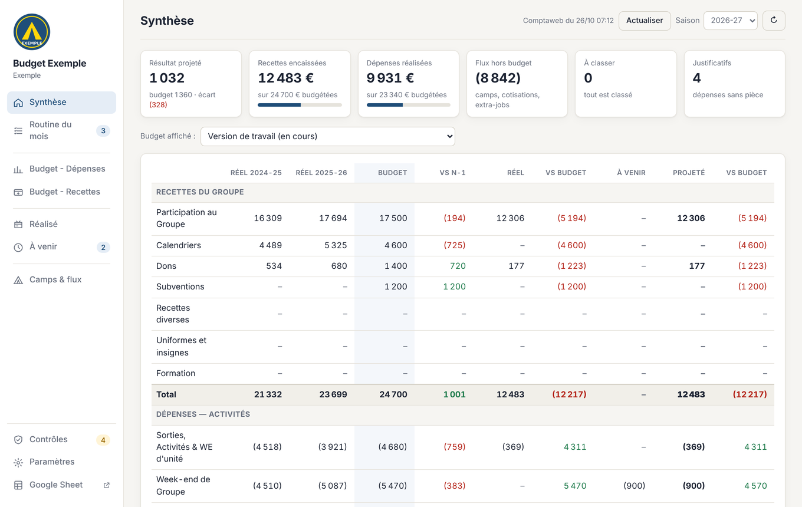
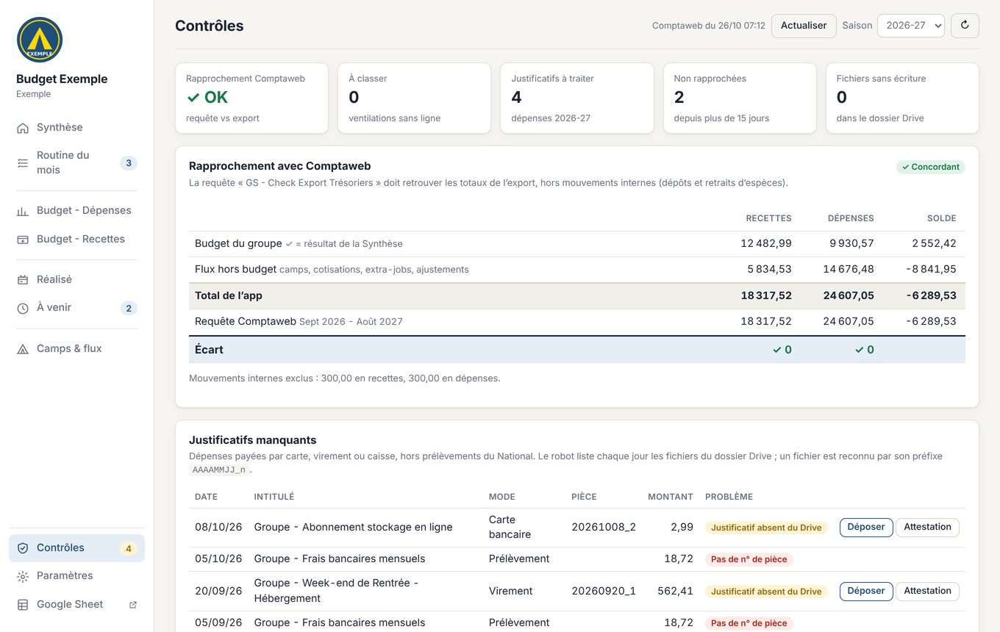

# Budget du groupe — application pour les trésoriers SGDF

Une application web gratuite pour **construire le budget du groupe, suivre le réalisé à partir de Comptaweb et tenir les contrôles de trésorerie**.
Elle tourne dans le compte Google du groupe : un Google Sheet sert de base de données, l'interface est une application Apps Script privée.
Développée par le groupe Saint-Lambert de Vaugirard (Paris 15e) et partagée avec les groupes du territoire.

| Synthèse | Contrôles |
|---|---|
|  |  |

## Ce que fait l'application

- **Synthèse** : budget, réel N-1 et N-2, réalisé, engagements à venir et projection de fin d'année, ligne par ligne.
- **Budget** : saisie guidée (€ par jeune et par unité, week-ends par catégorie, Participation au Mouvement calculée sur les effectifs), versions figées (budget voté) et comparaison.
- **Réalisé** : export Comptaweb classé automatiquement par règles (activité + nature → ligne de budget).
- **Contrôles** : rapprochement avec Comptaweb, justificatifs manquants (dépôt d'une photo depuis le téléphone, attestation sur l'honneur en PDF), écritures non rapprochées.
- **Routine du mois**, **camps et flux hors budget**, **fonds des équipes Compagnons**, **e-mail récapitulatif du lundi**.
- **Robot facultatif** (GitHub Actions) qui récupère chaque matin l'export Comptaweb et la liste des justificatifs du Drive.

## Documentation

| Document | Pour qui |
|---|---|
| [Plaquette de présentation](docs/plaquette_budget_du_groupe.pdf) | Tout le monde (2 pages) |
| [Guide d'installation](docs/guide_installation.pdf) | Le trésorier qui installe l'app pour la première fois |
| [Manuel du trésorier](docs/manuel_tresorier.pdf) | Utilisation au quotidien et personnalisation |

## Installer (résumé)

1. Créer un Google Sheet vide avec le compte Google de la trésorerie.
2. Extensions › Apps Script : coller [`installer/Code.gs`](installer/Code.gs) dans `Code.gs`, créer un fichier HTML `Index` et y coller [`installer/Index.html`](installer/Index.html).
3. Exécuter `installer`, puis `autoriser`.
4. Déployer › Nouveau déploiement › Application Web (exécuter en tant que : moi ; accès : moi uniquement).
5. Ouvrir l'app, renseigner Paramètres › Groupe, importer un export CSV de Comptaweb.

Le détail, avec captures, est dans le [guide d'installation](docs/guide_installation.pdf).
Pour essayer sans tes données : importe les exports fictifs du dossier [`exemple/`](exemple/).

## Mettre à jour

Le fichier [`VERSION`](VERSION) donne la dernière version ; l'app l'indique dans Paramètres › Groupe.
Pour mettre à jour : remplacer `Code.gs` et `Index` par ceux du dossier `installer/`, puis Déployer › Gérer les déploiements › Modifier › Nouvelle version. Les données ne changent pas.
Les nouveautés sont listées dans le [CHANGELOG](CHANGELOG.md).

## Contenu du dépôt

| Dossier | Contenu |
|---|---|
| `installer/` | Les 2 fichiers à coller dans Apps Script (générés, ne pas modifier) |
| `robot/` + `.github/workflows/` | Robot Comptaweb facultatif (Python + Selenium). Il ne s'exécute pas dans ce dépôt public : chaque groupe en fait une **copie privée** (voir le guide, chapitre « Robot ») |
| `source/` | Code source de l'app (`python3 source/build/build.py` reconstruit `installer/`) et tests |
| `exemple/` | Exports Comptaweb fictifs (« Groupe Exemple ») pour essayer l'app |
| `docs/` | Plaquette, guide d'installation, manuel du trésorier |

## Confidentialité

Les données restent dans le compte Google du groupe : rien n'est envoyé ailleurs. Les identifiants Comptaweb du robot sont stockés dans les secrets chiffrés du dépôt privé du groupe, jamais dans le classeur.

## Contact

Questions, idées, bugs : **tresoriers.slv@gmail.com** ou une *issue* sur ce dépôt.

Licence MIT — voir [LICENSE](LICENSE). Application indépendante, non éditée par l'association nationale des Scouts et Guides de France.
